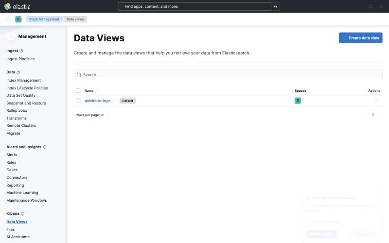
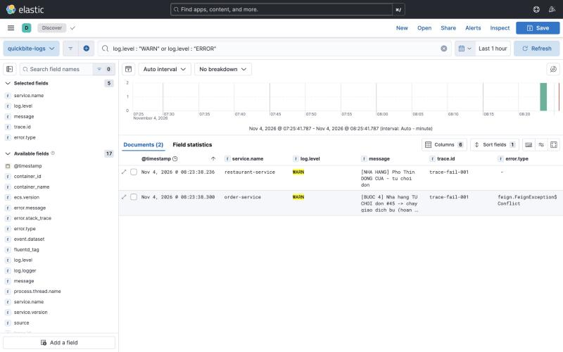
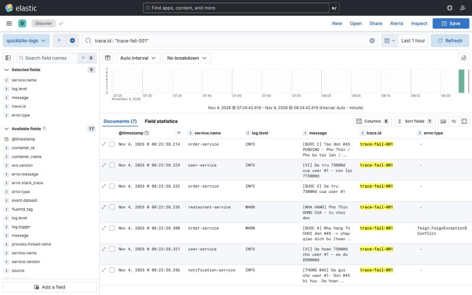

# Session 17 — Bài lab dựng EFK và truy vết log bằng traceId

> Quy ước đọc tài liệu: khối có nhãn `bash` là **lệnh để chạy**, khối không nhãn là **kết quả phải thấy**.

## A1. Bản đồ: slide ↔ tài liệu ↔ bài lab

| Slide | Tài liệu sinh viên | Bài lab |
|---|---|---|
| 4, 5 — Vì sao cần log tập trung | 1.1, 1.2 | PHẦN 4, PHẦN 5 |
| 6, 7 — Năm thành phần và luồng dữ liệu | 1.3, 1.4 | PHẦN 1 |
| 8 — Hai đường kết nối mạng | 1.5 | 3.1 |
| 9 — Bốn bước biến đổi log event | 1.6 | 4.4 |
| 10 — Ba cổng loopback | 1.7 | 1.5, 6.5 |
| 12 — Compose project độc lập | 2.1 | 1.1 |
| 13 — `vm.max_map_count` | 2.2 | 1.2 |
| 14 — Phiên bản và volume | 2.3 | 1.5 |
| 15 — Custom Fluentd image | 2.4 | 1.3 |
| 16, 17 — `fluent.conf` và buffer | 2.5, 2.6 | 1.4 |
| 18–22 — Ba service của compose | 2.3, 2.7 | 1.5, 1.6 |
| 23 — SSH tunnel | 2.8 | 6.6 |
| 25, 26, 28 — Logging driver | 3.1, 3.2 | 3.1, 3.2 |
| 27 — Chuẩn hoá tag | 3.3 | 3.1 |
| 29 — `reserve_data` | 3.4 | 6.2 |
| 30 — Ứng dụng độc lập với EFK | 3.5 | PHẦN 2 |
| 31 — Phải `--force-recreate` | 3.6 | 3.2, 3.3 |
| 32, 33 — Kiểm tra và chẩn đoán | 3.7 | 4.2, PHẦN 6 |
| 35, 37, 38 — Data view, cột, KQL | 4.1, 4.2, 4.3 | 5.1, 5.2, 5.3 |
| 39, 41 — Sáu bước debug phân tán | 4.4, 4.5 | 5.4 |
| 42 — Phân loại sự cố | 4.6, 4.7 | 5.5 |

> Slide 36 nói về Node Exporter và Spring Boot Actuator. Đó là nội dung của buổi 14, không thuộc buổi này. Slide 21 lặp lại nguyên văn slide 19.

## A2. Điều kiện cần

Buổi này dựng thêm một cụm ba container mới, bên cạnh hệ thống QuickBite đã có từ `session-05`.

**Lệnh** — kiểm tra sáu container của hệ thống cũ

```bash
docker ps --format '{{.Names}}' | grep quickbite5- | sort
```

**Ví dụ**

```
quickbite5-db
quickbite5-gateway
quickbite5-notification
quickbite5-order
quickbite5-restaurant
quickbite5-user
```

**Lệnh** — nếu thiếu container nào

```bash
cd ~/Downloads/quickbite-demo/session-05 && ./start-all.sh
```

**Lệnh** — nạp lại ví của `user #1` trước khi vào bài

```bash
docker exec quickbite5-db psql -U postgres -d quickbite_user_db -c "UPDATE users SET wallet_balance = 1000000 WHERE id = 1;"
```

**Ví dụ**

```
UPDATE 1
```

**Giải thích**

| Thứ | Vì sao cần |
|---|---|
| 6 container `quickbite5-*` | Nguồn log của cả buổi học |
| Mạng `quickbite5-net` | Cụm EFK gắn vào mạng này bằng khai báo `external: true` |
| Ví của `user #1` | Mỗi đơn trừ 75.000đ; ví cạn làm đơn hỏng ở `[BUOC 3]` và lẫn với sự cố dựng ở PHẦN 5 |
| RAM trống tối thiểu 3 GB | Elasticsearch cố định 1 GB heap, Kibana chiếm thêm khoảng 1 GB |

**Lệnh** — kiểm tra RAM mà Docker đang có

```bash
docker info --format 'Tong RAM: {{.MemTotal}} bytes'
```

**Ví dụ**

```
Tong RAM: 8319504384 bytes
```

Dưới 4 GB thì nên tắt bớt container của dự án khác trước khi dựng Elasticsearch.

## A3. Tạo thư mục làm việc

**Lệnh** — về thư mục gốc của dự án

```bash
cd ~/Downloads/quickbite-demo
```

**Lệnh** — tạo cấu trúc thư mục cho buổi 17

```bash
mkdir -p LAB_SS17/efk/fluentd
```

**Lệnh** — kiểm tra

```bash
ls -R LAB_SS17
```

**Ví dụ**

```
LAB_SS17:
efk

LAB_SS17/efk:
fluentd

LAB_SS17/efk/fluentd:
```

**Giải thích**

| Thư mục | Nội dung sẽ tạo |
|---|---|
| `LAB_SS17/efk/` | `docker-compose.yml` của cụm EFK — một compose project riêng |
| `LAB_SS17/efk/fluentd/` | `Dockerfile` và `fluent.conf` của collector |
| `LAB_SS17/` | `logging-fluentd.yml` — file chồng lên compose của `session-05` |

## A4. Kiểm tra bất cứ lúc nào

**Lệnh**

```bash
cd ~/Downloads/quickbite-demo/LAB_SS17/efk && ./check.sh
```

**Giải thích**

Script kiểm **17 mục** theo đúng thứ tự các phần của bài. Khi mới bắt đầu, mọi mục từ PHẦN 1 trở đi đều đỏ.

---

# PHẦN 1 — DỰNG CỤM EFK

## 1.1 · Vào thư mục của cụm EFK

**Lệnh**

```bash
cd ~/Downloads/quickbite-demo/LAB_SS17/efk
```

**Giải thích**

Mọi lệnh của PHẦN 1 chạy trong thư mục này. Đây là **compose project thứ hai**, hoàn toàn tách khỏi `session-05/stack`. Hai project chỉ gặp nhau ở mạng `quickbite5-net`.

## 1.2 · Kiểm tra tham số kernel của host

**Lệnh**

```bash
docker run --rm --privileged --pid=host alpine nsenter -t 1 -m -u -i -n sysctl vm.max_map_count
```

**Ví dụ**

```
vm.max_map_count = 262144
```

**Giải thích**

Elasticsearch 8.x cần `vm.max_map_count` tối thiểu 262144. Lệnh trên đọc tham số của **nhân Linux nơi Docker thực sự chạy**:

| Hệ điều hành | Kết quả | Việc phải làm |
|---|---|---|
| macOS, Windows | Đã là `262144` | Không cần làm gì — máy ảo của Docker Desktop đặt sẵn |
| Linux host (VPS) | Thường là `65530` | Chạy hai lệnh ở mục 2.2 của tài liệu sinh viên |

Trên VPS Ubuntu, bỏ qua bước này làm Elasticsearch khởi động rồi chết ngay với lỗi `max virtual memory areas vm.max_map_count [65530] is too low`.

## 1.3 · Tạo `fluentd/Dockerfile`

**Lệnh**

```bash
nano fluentd/Dockerfile
```

**Nội dung file**

```
FROM fluent/fluentd:v1.19.3-debian-2.2
USER root
RUN gem install elasticsearch --no-document --version 8.19.0 \
 && gem install fluent-plugin-elasticsearch --no-document --version 5.4.3 \
 && mkdir -p /fluentd/buffer \
 && chown -R fluent:fluent /fluentd
USER fluent
```

Lưu file: `Ctrl+O` → `Enter` → `Ctrl+X`.

**Lệnh** — kiểm tra

```bash
cat fluentd/Dockerfile | head -3
```

**Ví dụ**

```
FROM fluent/fluentd:v1.19.3-debian-2.2
USER root
RUN gem install elasticsearch --no-document --version 8.19.0 \
```

**Giải thích**

Image Fluentd gốc không có plugin Elasticsearch. Hai lệnh `gem install` bổ sung plugin đó cùng client Ruby tương ứng. Dòng `USER fluent` cuối file trả tiến trình về người dùng thường sau khi đã cài xong.

## 1.4 · Tạo `fluentd/fluent.conf`

**Lệnh**

```bash
nano fluentd/fluent.conf
```

**Nội dung file**

```
# 1. NHAN LOG tu Docker logging driver
<source>
  @type forward
  port 24224
  bind 0.0.0.0
</source>

# 2. PARSE truong "log" (chuoi JSON do Spring Boot in ra)
<filter quickbite.**>
  @type parser
  key_name log
  reserve_data true
  remove_key_name_field true
  <parse>
    @type json
  </parse>
</filter>

# 2b. DON dong KHONG phai JSON (banner khoi dong, canh bao cua JVM)
<filter quickbite.**>
  @type record_transformer
  enable_ruby true
  remove_keys log
  <record>
    message ${record["message"] || record["log"]}
  </record>
</filter>

# 3. GHI vao Elasticsearch, co buffer tren dia
<match quickbite.**>
  @type elasticsearch
  host elasticsearch
  port 9200
  scheme http
  logstash_format true
  logstash_prefix quickbite
  logstash_dateformat %Y.%m.%d
  include_tag_key true
  tag_key fluentd_tag
  suppress_type_name true
  log_es_400_reason true
  <buffer>
    @type file
    path /fluentd/buffer/quickbite
    flush_mode interval
    flush_interval 5s
    retry_forever true
    chunk_limit_size 8m
    total_limit_size 512m
  </buffer>
</match>

# Log noi bo cua chinh Fluentd -> chi in ra stdout
<label @FLUENT_LOG>
  <match **>
    @type stdout
  </match>
</label>

# Tag khong bat dau bang quickbite. -> in ra stdout de debug
<match **>
  @type stdout
</match>
```

Lưu file: `Ctrl+O` → `Enter` → `Ctrl+X`.

**Lệnh** — kiểm tra ba khối chính có đủ

```bash
grep -nE '^<(source|filter|match|label)' fluentd/fluent.conf
```

**Ví dụ**

```
2:<source>
9:<filter quickbite.**>
19:<filter quickbite.**>
29:<match quickbite.**>
53:<label @FLUENT_LOG>
60:<match **>
```

Số dòng thay đổi theo lượng chú thích trong file. Điều phải thấy: **một `<source>`, hai `<filter>`, hai `<match>` và một `<label>`**.

**Giải thích**

| Tham số | Vì sao có mặt |
|---|---|
| `remove_key_name_field true` | Bỏ trường `log` gốc sau khi parse. **Thiếu dòng này, Elasticsearch từ chối toàn bộ document** — xem mục 6.2 |
| Khối `<filter>` thứ hai | Dọn những dòng **không phải JSON**. Parser bỏ qua chúng và giữ nguyên trường `log` dạng chuỗi; chỉ cần một document như vậy lọt vào là mapping hỏng — xem mục 6.2 |
| `enable_ruby true` | Cho phép viết biểu thức `${record["message"] \|\| record["log"]}` |
| `suppress_type_name true` | Elasticsearch 8 đã bỏ `_type`; gửi kèm sẽ bị trả `400` |
| `log_es_400_reason true` | In lý do thật khi Elasticsearch trả `400`, thay vì chỉ một dòng `Rejected by Elasticsearch` |
| `<label @FLUENT_LOG>` | Tách log nội bộ của Fluentd khỏi luồng dữ liệu; thiếu nó Fluentd in cảnh báo `deprecated` mỗi lần khởi động |
| `retry_forever true` | Không bao giờ bỏ log; đổi lại, một chunk hỏng sẽ được thử lại vô hạn — xem mục 6.3 |

## 1.5 · Tạo `docker-compose.yml` của cụm EFK

**Lệnh**

```bash
nano docker-compose.yml
```

**Nội dung file**

```
services:

  elasticsearch:
    image: docker.elastic.co/elasticsearch/elasticsearch:8.15.0
    container_name: quickbite-elasticsearch
    environment:
      discovery.type: single-node
      xpack.security.enabled: "false"
      ES_JAVA_OPTS: "-Xms1g -Xmx1g"
    volumes:
      - elasticsearch-data:/usr/share/elasticsearch/data
    ports:
      - "127.0.0.1:9200:9200"
    healthcheck:
      test: ["CMD-SHELL", "curl -s http://localhost:9200/_cluster/health | grep -q '\"status\"'"]
      interval: 10s
      timeout: 5s
      retries: 30
      start_period: 60s
    networks:
      - quickbite5-net
    restart: unless-stopped

  kibana:
    image: docker.elastic.co/kibana/kibana:8.15.0
    container_name: quickbite-kibana
    environment:
      ELASTICSEARCH_HOSTS: '["http://elasticsearch:9200"]'
    ports:
      - "127.0.0.1:5601:5601"
    depends_on:
      elasticsearch:
        condition: service_healthy
    networks:
      - quickbite5-net
    restart: unless-stopped

  fluentd:
    build:
      context: ./fluentd
    image: quickbite-fluentd:1.19.3
    container_name: quickbite-fluentd
    volumes:
      - ./fluentd/fluent.conf:/fluentd/etc/fluent.conf:ro
      - fluentd-buffer:/fluentd/buffer
    environment:
      FLUENTD_CONF: fluent.conf
    ports:
      - "127.0.0.1:24224:24224"
      - "127.0.0.1:24224:24224/udp"
    depends_on:
      elasticsearch:
        condition: service_healthy
    networks:
      - quickbite5-net
    restart: unless-stopped

volumes:
  elasticsearch-data:
  fluentd-buffer:

networks:
  quickbite5-net:
    external: true
```

Lưu file: `Ctrl+O` → `Enter` → `Ctrl+X`.

**Lệnh** — kiểm tra cú pháp YAML

```bash
docker compose config -q && echo "YAML hop le"
```

**Ví dụ**

```
YAML hop le
```

**Lệnh** — kiểm tra ba service đã khai báo

```bash
docker compose config --services
```

**Ví dụ**

```
elasticsearch
kibana
fluentd
```

**Lệnh** — kiểm tra mạng dùng chung đã tồn tại

```bash
docker network inspect quickbite5-net --format '{{.Name}} {{.Driver}}'
```

**Ví dụ**

```
quickbite5-net bridge
```

**Giải thích**

| Khai báo | Lý do |
|---|---|
| `127.0.0.1:9200:9200` | Chỉ máy cục bộ gọi được; không có tiền tố `127.0.0.1` thì cổng mở ra toàn internet |
| `ES_JAVA_OPTS: "-Xms1g -Xmx1g"` | Cố định heap; không đặt, Elasticsearch tự lấy một nửa RAM máy |
| `condition: service_healthy` | Kibana và Fluentd chỉ khởi động sau khi Elasticsearch trả lời healthcheck |
| `external: true` | Mạng do `session-05` tạo; compose của EFK chỉ gắn vào, không tạo mới |
| Hai named volume | Index và buffer sống sót khi container bị xoá |

> ⚠️ `networks: external: true` yêu cầu mạng **phải có sẵn**. Chưa chạy `session-05` mà dựng EFK trước sẽ gặp lỗi `network quickbite5-net declared as external, but could not be found`.

## 1.6 · Dựng ba container

**Lệnh**

```bash
docker compose up -d --build
```

**Ví dụ** — phần cuối của kết quả

```
 Container quickbite-elasticsearch  Healthy
 Container quickbite-kibana         Started
 Container quickbite-fluentd        Started
```

**Giải thích**

Lần chạy đầu tiên tải khoảng 3,6 GB image và build image Fluentd, mất vài phút tuỳ đường truyền. Dòng `Healthy` của Elasticsearch xuất hiện trước khi hai container còn lại khởi động — đó là `depends_on` đang làm việc.

**Lệnh** — xem trạng thái

```bash
docker compose ps --format 'table {{.Name}}\t{{.Service}}\t{{.Status}}'
```

**Ví dụ**

```
NAME                      SERVICE         STATUS
quickbite-elasticsearch   elasticsearch   Up 6 minutes (healthy)
quickbite-fluentd         fluentd         Up 3 minutes
quickbite-kibana          kibana          Up 6 minutes
```

## 1.7 · Kiểm tra Elasticsearch

**Lệnh**

```bash
curl -s 'http://127.0.0.1:9200/_cat/health?v'
```

**Ví dụ**

```
epoch      timestamp cluster        status node.total node.data shards pri relo init unassign pending_tasks max_task_wait_time active_shards_percent
1793755573 01:26:13  docker-cluster yellow          1         1     30  30    0    0        1             0                  -                 96.8%
```

**Giải thích**

`status yellow` là **bình thường** với cụm một node. Elasticsearch muốn đặt bản sao (replica) của mỗi index lên một node khác, nhưng chỉ có một node nên bản sao không có chỗ. Dữ liệu vẫn đọc ghi đầy đủ. Chỉ `red` mới là mất dữ liệu.

**Lệnh** — xem phiên bản

```bash
curl -s http://127.0.0.1:9200 | grep -E '"number"|"cluster_name"'
```

**Ví dụ**

```
  "cluster_name" : "docker-cluster",
    "number" : "8.15.0",
```

## 1.8 · Kiểm tra Kibana

**Lệnh**

```bash
curl -s -o /dev/null -w "HTTP %{http_code}\n" http://127.0.0.1:5601/api/status
```

**Ví dụ**

```
HTTP 200
```

**Giải thích**

Kibana cần 60–120 giây sau khi container `Started` mới trả `HTTP 200`. Trong thời gian đó trình duyệt hiện màn hình `Kibana server is not ready yet`. Chờ thêm, không dựng lại container.

**Lệnh** — mở giao diện

```bash
open http://127.0.0.1:5601
```

Trên Linux dùng `xdg-open` thay cho `open`.

---

# PHẦN 2 — ỨNG DỤNG IN LOG JSON CHUẨN ECS

Phần này **không sửa mã nghiệp vụ**. Mục tiêu là đọc hiểu bốn thay đổi đã có sẵn trong `session-05/stack`, rồi build lại để chúng có hiệu lực.

## 2.1 · Vào thư mục của hệ thống QuickBite

**Lệnh**

```bash
cd ~/Downloads/quickbite-demo/session-05/stack
```

## 2.2 · Thư viện sinh JSON chuẩn ECS

**Lệnh**

```bash
grep -n 'logback-ecs-encoder' */build.gradle
```

**Ví dụ**

```
notification-service/build.gradle:14:    implementation 'co.elastic.logging:logback-ecs-encoder:1.6.0'
order-service/build.gradle:17:    implementation 'co.elastic.logging:logback-ecs-encoder:1.6.0'
restaurant-service/build.gradle:14:    implementation 'co.elastic.logging:logback-ecs-encoder:1.6.0'
user-service/build.gradle:14:    implementation 'co.elastic.logging:logback-ecs-encoder:1.6.0'
```

**Giải thích**

ECS (Elastic Common Schema) là bộ tên trường chuẩn của Elastic: `@timestamp`, `log.level`, `service.name`, `trace.id`, `error.type`. Dùng đúng tên chuẩn thì Kibana nhận ra ngay mà không phải cấu hình thêm.

Đây là **thư viện duy nhất** được thêm vào. Không có SDK Fluentd, không có địa chỉ Elasticsearch trong mã nguồn.

## 2.3 · Hai định dạng log trong `logback-spring.xml`

**Lệnh**

```bash
grep -n 'springProfile\|EcsEncoder\|serviceName' order-service/src/main/resources/logback-spring.xml
```

**Ví dụ**

```
13:  <springProfile name="!json">
21:  <springProfile name="json">
24:      <encoder class="co.elastic.logging.logback.EcsEncoder">
25:        <serviceName>order-service</serviceName>
```

**Giải thích**

| Profile | Định dạng | Dùng khi |
|---|---|---|
| `!json` (mặc định) | Dòng text căn cột của Spring Boot | Chạy máy cá nhân, buổi 16 |
| `json` | JSON chuẩn ECS một dòng | Bật bằng `SPRING_PROFILES_ACTIVE=json`, dùng cho EFK |

Nhờ hai profile này, bài lab buổi 16 vẫn chạy nguyên vẹn sau buổi 17: không bật profile thì log vẫn là định dạng cũ.

## 2.4 · Lớp sinh và truyền `trace.id`

**Lệnh**

```bash
grep -n 'HEADER\|MDC_KEY\|MDC.put' order-service/src/main/java/com/quickbite/order/TraceIdFilter.java
```

**Ví dụ**

```
24:    public static final String HEADER  = "X-Trace-Id";
25:    public static final String MDC_KEY = "trace.id";
36:        MDC.put(MDC_KEY, traceId);
```

**Lệnh** — lớp chuyển tiếp sang service khác

```bash
grep -n 'RequestInterceptor\|template.header' order-service/src/main/java/com/quickbite/order/FeignTraceConfig.java
```

**Ví dụ**

```
16:    public RequestInterceptor traceIdForwarder() {
20:                template.header(TraceIdFilter.HEADER, traceId);
```

**Giải thích**

| Lớp | Có ở service nào | Nhiệm vụ |
|---|---|---|
| `TraceIdFilter` | Cả bốn service | Đọc header `X-Trace-Id`, không có thì tự sinh, đặt vào MDC |
| `FeignTraceConfig` | Chỉ `order-service` | Gắn lại header đó vào mọi lời gọi Feign |

`order-service` là service duy nhất gọi sang service khác, nên chỉ nó cần `FeignTraceConfig`. Ba service còn lại chỉ nhận.

MDC gắn với **thread đang xử lý request**. Vì thread được tái sử dụng cho request sau, `TraceIdFilter` phải gọi `MDC.remove` trong khối `finally`.

## 2.5 · Build lại bốn file JAR

**Lệnh**

```bash
for d in order-service user-service restaurant-service notification-service; do
  docker run --rm -v "$PWD/$d":/home/gradle/project \
    -v quickbite-gradle-cache:/home/gradle/.gradle \
    -w /home/gradle/project gradle:8.10-jdk17 gradle bootJar --no-daemon -q
done
```

**Lệnh** — kiểm tra bốn file JAR vừa sinh

```bash
ls -l */build/libs/*.jar | awk '{print $NF, $6, $7, $8}'
```

**Ví dụ**

```
api-gateway/build/libs/api-gateway.jar Sep 23 10:23
notification-service/build/libs/notification-service.jar Nov 4 08:09
order-service/build/libs/order-service.jar Nov 4 08:09
restaurant-service/build/libs/restaurant-service.jar Nov 4 08:09
user-service/build/libs/user-service.jar Nov 4 08:09
```

**Giải thích**

Bốn JAR mang mốc thời gian của lần build gần nhất; `api-gateway.jar` giữ mốc cũ vì gateway không nằm trong danh sách build. Chạy lại lệnh khi mã nguồn không đổi thì Gradle báo `UP-TO-DATE` và **không ghi lại file**, nên mốc thời gian cũng không đổi.

Lệnh build chạy Gradle **bên trong container**, nên máy không cần cài JDK. Volume `quickbite-gradle-cache` giữ thư viện đã tải để lần sau nhanh hơn.

## 2.6 · Build lại bốn image

**Lệnh**

```bash
docker compose build order-service user-service restaurant-service notification-service
```

**Ví dụ** — phần cuối

```
 Image stack-notification-service  Built
 Image stack-order-service         Built
 Image stack-user-service          Built
 Image stack-restaurant-service    Built
```

**Giải thích**

`Dockerfile` của mỗi service chỉ sao chép file JAR vào image. JAR đã đổi ở mục 2.5 nên image phải build lại thì mã mới có hiệu lực.

---

# PHẦN 3 — GẮN LOGGING DRIVER CHO BỐN SERVICE

## 3.1 · Tạo file chồng `logging-fluentd.yml`

**Lệnh**

```bash
cd ~/Downloads/quickbite-demo/LAB_SS17
```

**Lệnh**

```bash
nano logging-fluentd.yml
```

**Nội dung file**

```
services:

  order-service:
    environment:
      - SPRING_PROFILES_ACTIVE=json
      - SPRING_MAIN_BANNER_MODE=off
    logging:
      driver: fluentd
      options:
        fluentd-address: "127.0.0.1:24224"
        fluentd-async: "true"
        tag: "quickbite.order"

  user-service:
    environment:
      - SPRING_PROFILES_ACTIVE=json
      - SPRING_MAIN_BANNER_MODE=off
    logging:
      driver: fluentd
      options:
        fluentd-address: "127.0.0.1:24224"
        fluentd-async: "true"
        tag: "quickbite.user"

  restaurant-service:
    environment:
      - SPRING_PROFILES_ACTIVE=json
      - SPRING_MAIN_BANNER_MODE=off
    logging:
      driver: fluentd
      options:
        fluentd-address: "127.0.0.1:24224"
        fluentd-async: "true"
        tag: "quickbite.restaurant"

  notification-service:
    environment:
      - SPRING_PROFILES_ACTIVE=json
      - SPRING_MAIN_BANNER_MODE=off
    logging:
      driver: fluentd
      options:
        fluentd-address: "127.0.0.1:24224"
        fluentd-async: "true"
        tag: "quickbite.notification"
```

Lưu file: `Ctrl+O` → `Enter` → `Ctrl+X`.

**Lệnh** — kiểm tra bốn tag đã khai đủ

```bash
grep -c 'tag:' logging-fluentd.yml
```

**Ví dụ**

```
4
```

**Giải thích**

| Khai báo | Tác dụng |
|---|---|
| `SPRING_PROFILES_ACTIVE=json` | Chuyển Logback sang encoder ECS |
| `SPRING_MAIN_BANNER_MODE=off` | Tắt banner ASCII của Spring Boot. Banner **không phải JSON**, lọt vào index sẽ làm hỏng mapping — xem mục 6.2 |
| `driver: fluentd` | Docker gửi log sang collector thay vì ghi file trên host |
| `fluentd-address: "127.0.0.1:24224"` | Địa chỉ **nhìn từ tiến trình `dockerd`**, không phải từ trong container |
| `fluentd-async: "true"` | Collector chưa sẵn sàng thì container vẫn khởi động được |
| `tag: "quickbite.<ten>"` | Khớp với `quickbite.**` trong `fluent.conf` |

> ⚠️ Không thay `127.0.0.1` bằng `fluentd` hay `quickbite-fluentd`. Tên container chỉ phân giải được trong mạng Docker, còn `dockerd` chạy ngoài mạng đó.

File này **chồng lên** `session-05/stack/docker-compose.yml`, không sửa một dòng nào trong đó.

## 3.2 · Áp dụng file chồng

**Lệnh**

```bash
cd ~/Downloads/quickbite-demo/session-05/stack
```

**Lệnh** — kiểm tra cú pháp trước khi áp dụng

```bash
docker compose -f docker-compose.yml -f ../../LAB_SS17/logging-fluentd.yml config -q && echo "Hop le"
```

**Ví dụ**

```
Hop le
```

**Lệnh** — tái tạo container với cấu hình mới

```bash
docker compose -f docker-compose.yml -f ../../LAB_SS17/logging-fluentd.yml up -d --force-recreate
```

**Ví dụ** — phần cuối

```
 Container quickbite5-notification  Started
 Container quickbite5-order         Started
 Container quickbite5-user          Started
 Container quickbite5-restaurant    Started
 Container quickbite5-gateway       Started
```

**Giải thích**

`--force-recreate` huỷ và tạo lại container. Không có cờ này, Docker thấy image không đổi nên giữ nguyên container cũ, và logging driver **không** đổi. `docker compose restart` cũng không có tác dụng vì nó chỉ khởi động lại container đã tạo.

## 3.3 · Xác nhận driver đã đổi

**Lệnh**

```bash
for c in quickbite5-order quickbite5-user quickbite5-restaurant quickbite5-notification quickbite5-gateway; do
  printf "%-28s %s\n" $c "$(docker inspect --format '{{.HostConfig.LogConfig.Type}}' $c)"
done
```

**Ví dụ**

```
quickbite5-order             fluentd
quickbite5-user              fluentd
quickbite5-restaurant        fluentd
quickbite5-notification      fluentd
quickbite5-gateway           json-file
```

**Giải thích**

Bốn service nghiệp vụ dùng `fluentd`. `api-gateway` vẫn ở `json-file` vì file chồng không khai báo nó — gateway chạy trên WebFlux, không có `TraceIdFilter`, nên buổi này để nguyên.

## 3.4 · Chờ hệ thống sẵn sàng

**Lệnh** — chờ tới khi gateway trả lời

```bash
for i in $(seq 1 40); do curl -fsS -m 3 http://localhost:8000/actuator/health >/dev/null 2>&1 && break; sleep 3; done; echo "gateway san sang"
```

**Ví dụ**

```
gateway san sang
```

**Giải thích**

Bốn service Spring Boot cần khoảng 15 giây để khởi động xong sau khi tái tạo. Gọi sớm hơn sẽ nhận:

```
curl: (56) Recv failure: Connection reset by peer
```

Container đã `Up` nhưng tiến trình Java bên trong chưa mở cổng, nên Docker chấp nhận kết nối rồi đóng ngay. **`Up` không đồng nghĩa với sẵn sàng nhận request.** Vòng lặp trên thử lại mỗi ba giây, tối đa hai phút.

## 3.5 · Xem Fluentd có nhận được gì không

**Lệnh**

```bash
docker logs --tail 5 quickbite-fluentd
```

**Ví dụ** — khi mọi thứ bình thường

```
2026-11-04 01:20:27 +0000 [info]: #0 listening port port=24224 bind="0.0.0.0"
2026-11-04 01:20:27 +0000 [info]: #0 fluentd worker is now running worker=0
```

**Giải thích**

Fluentd **không in từng dòng log nhận được**. Khối `<match quickbite.**>` gửi thẳng sang Elasticsearch, không qua `stdout`. Khi khối này chạy đúng thì log của Fluentd im lặng. Chỉ khi có lỗi mới xuất hiện dòng `[warn]` hoặc `[error]`.

---

# PHẦN 4 — KIỂM TRA PIPELINE BẰNG DÒNG LỆNH

## 4.1 · Đặt một đơn hàng có `trace.id` xác định

**Lệnh**

```bash
cd ~/Downloads/quickbite-demo/session-05/stack
```

**Lệnh**

```bash
curl -s -o /dev/null -w "order HTTP %{http_code}\n" \
  -X POST "http://localhost:8000/api/v1/orders?userId=1&restaurantId=1" \
  -H "X-Trace-Id: trace-demo-001"
```

**Ví dụ**

```
order HTTP 200
```

**Giải thích**

Header `X-Trace-Id` do người gọi đặt. `TraceIdFilter` của `order-service` đọc nó, đưa vào MDC, và `FeignTraceConfig` gắn lại vào ba lời gọi sang `user`, `restaurant`, `notification`. Nhờ vậy cả bốn service cùng ghi một giá trị `trace.id`.

Không truyền header thì filter tự sinh giá trị dạng `auto-1a2b3c4d`, vẫn truy vết được nhưng phải tìm mới biết.

## 4.2 · Kiểm tra index đã được tạo

**Lệnh** — chờ Fluentd đẩy lô dữ liệu

```bash
sleep 10 && curl -s 'http://127.0.0.1:9200/_cat/indices/quickbite-*?v'
```

**Ví dụ**

```
health status index                uuid                   pri rep docs.count docs.deleted store.size pri.store.size dataset.size
yellow open   quickbite-2026.11.04 oalGHTUpT9CyQ2n3I1HAQQ   1   1         88            0    142.1kb        142.1kb      142.1kb
```

**Giải thích**

| Cột | Ý nghĩa |
|---|---|
| `quickbite-2026.11.04` | Tên index theo ngày, do `logstash_prefix` và `logstash_dateformat` sinh ra |
| `docs.count` | Số dòng log đã lưu; phải tăng mỗi lần đặt đơn mới |
| `yellow` | Replica chưa có chỗ đặt vì chỉ có một node |

`sleep 10` là cần thiết: `flush_interval 5s` nghĩa là Fluentd gom log tối đa năm giây trước khi gửi.

## 4.3 · Lấy toàn bộ log của một request

**Lệnh**

```bash
curl -s 'http://127.0.0.1:9200/quickbite-*/_search?q=trace.id:%22trace-demo-001%22&size=20&sort=@timestamp:asc' \
| python3 -c "
import sys,json
d=json.load(sys.stdin)
print('Tong so dong:',d['hits']['total']['value'])
for h in d['hits']['hits']:
    s=h['_source']
    print(s['@timestamp'][11:23], s.get('log.level'), '|', s.get('service.name'), '|', str(s.get('message'))[:58])
"
```

**Ví dụ**

```
Tong so dong: 7
01:37:49.724 INFO | order-service | [BUOC 2] Tao don #48 PENDING - Pho Thin / Pho bo tai lan /
01:37:49.756 INFO | user-service | [VI] Da tru 75000d cua user #1 - con lai 925000d
01:37:49.781 INFO | order-service | [BUOC 3] Da tru 75000d cua user #1
01:37:49.787 INFO | restaurant-service | [NHA HANG] Pho Thin da nhan don - mon Pho bo tai lan
01:37:49.789 INFO | order-service | [BUOC 4] Nha hang Pho Thin da nhan don #48
01:37:49.930 INFO | notification-service | [THONG BAO] Da gui cho user #1: Don #48 da duoc xac nhan
01:37:49.965 INFO | order-service | [BUOC 5-6] Don #48 CONFIRMED, da gui thong bao
```

**Giải thích**

Đây là điều mà buổi 16 **không làm được**: bảy dòng log của bốn container khác nhau, xếp đúng thứ tự thời gian, chỉ bằng một lần lọc. Toàn bộ hành trình đặt hàng kéo dài 241 mili giây.

Số thứ tự đơn hàng và mốc thời gian khác nhau mỗi lần chạy. Điều phải thấy: **bảy dòng, đủ bốn tên service, mốc thời gian tăng dần**.

Đặt thêm một đơn nữa với **cùng** `trace.id` thì số dòng cộng dồn thành 14. Mỗi lần thử nên dùng một `trace.id` khác nhau.

## 4.4 · Xem một document đầy đủ

**Lệnh**

```bash
curl -s 'http://127.0.0.1:9200/quickbite-*/_search?size=1&q=BUOC%202' \
| python3 -c "import sys,json;print(json.dumps(json.load(sys.stdin)['hits']['hits'][0]['_source'],indent=1,ensure_ascii=False))"
```

**Ví dụ**

```
{
 "container_name": "/quickbite5-order",
 "source": "stdout",
 "container_id": "28381b73751539a8380beb2fd653594b8a728a3e6e42b3547cd5b76481702f18",
 "@timestamp": "2026-11-04T01:37:49.724Z",
 "log.level": "INFO",
 "message": "[BUOC 2] Tao don #48 PENDING - Pho Thin / Pho bo tai lan / 75000d",
 "ecs.version": "1.2.0",
 "service.name": "order-service",
 "service.version": "1.0.0",
 "event.dataset": "order-service",
 "process.thread.name": "http-nio-8083-exec-2",
 "log.logger": "com.quickbite.order.OrderController",
 "trace.id": "trace-demo-001",
 "fluentd_tag": "quickbite.order"
}
```

**Giải thích**

| Nhóm trường | Nguồn |
|---|---|
| `container_name`, `container_id`, `source` | Docker thêm vào; còn lại nhờ `reserve_data true` |
| `@timestamp`, `log.level`, `message`, `service.name`, `trace.id` | Spring Boot sinh ra theo chuẩn ECS |
| `fluentd_tag` | Fluentd thêm vào nhờ `include_tag_key true` |

Không còn trường `log` chứa chuỗi JSON thô — `remove_key_name_field true` đã bỏ nó sau khi parse.

## 4.5 · Đếm log theo field

**Lệnh**

```bash
curl -s 'http://127.0.0.1:9200/quickbite-*/_count?q=service.name:%22order-service%22'
```

**Ví dụ**

```
{"count":25,"_shards":{"total":1,"successful":1,"skipped":0,"failed":0}}
```

**Lệnh** — đếm theo level

```bash
curl -s 'http://127.0.0.1:9200/quickbite-*/_count?q=log.level:INFO'
```

**Ví dụ**

```
{"count":88,"_shards":{"total":1,"successful":1,"skipped":0,"failed":0}}
```

**Giải thích**

Hai con số phụ thuộc vào lượng log đã tích luỹ trong index, nên khác nhau trên mỗi máy và tăng dần trong buổi học.

Hai lệnh này trả lời được vì `service.name` và `log.level` là **field riêng** đã được lập chỉ mục. Nếu parser không chạy, cả hai đều trả `"count":0` dù dữ liệu vẫn nằm trong Elasticsearch — xem mục 6.2.

---

# PHẦN 5 — PHÂN TÍCH TRONG KIBANA

## 5.1 · Tạo data view

**Thao tác trên giao diện**

| Bước | Việc làm |
|---|---|
| 1 | Mở `http://127.0.0.1:5601` |
| 2 | Menu bên trái → **Stack Management** → **Data Views** |
| 3 | Bấm **Create data view** |
| 4 | Name: `quickbite-logs` · Index pattern: `quickbite-*` · Timestamp field: `@timestamp` |
| 5 | Bấm **Save data view to Kibana** |



**Lệnh** — kiểm tra bằng dòng lệnh

```bash
curl -s 'http://127.0.0.1:5601/api/data_views' | python3 -c "import sys,json;[print(v['name'],'->',v['title']) for v in json.load(sys.stdin)['data_view']]"
```

**Ví dụ**

```
quickbite-logs -> quickbite-*
```

**Giải thích**

Index pattern có dấu `*` để bao mọi ngày. Trường `@timestamp` cho phép Kibana lọc theo Time Range và vẽ biểu đồ phân bố log.

## 5.2 · Chuẩn bị bảng Discover

**Thao tác trên giao diện**

| Bước | Việc làm |
|---|---|
| 1 | Menu bên trái → **Discover** |
| 2 | Chọn data view `quickbite-logs` ở góc trên bên trái |
| 3 | Đặt Time Range thành **Last 1 hour** |
| 4 | Ở cột **Available fields**, bấm dấu `+` lần lượt cho: `service.name`, `log.level`, `message`, `trace.id`, `error.type` |

**Giải thích**

| Cột | Câu hỏi nó trả lời |
|---|---|
| `@timestamp` | Sự kiện xảy ra khi nào |
| `service.name` | Service nào tạo log |
| `log.level` | Mức độ nghiêm trọng |
| `message` | Sự kiện nghiệp vụ nào |
| `trace.id` | Dòng log thuộc request nào |
| `error.type` | Exception thuộc loại nào |

Không chọn cột thì Discover hiển thị cả document JSON trên một dòng, rất khó đọc.

## 5.3 · Ba truy vấn KQL

**Truy vấn 1 — mọi lỗi trong khoảng thời gian**

```
log.level : "WARN" or log.level : "ERROR"
```



**Truy vấn 2 — lỗi gọi liên service**

```
error.type : "feign.FeignException*"
```

**Truy vấn 3 — toàn bộ log của một request**

```
trace.id : "trace-demo-001"
```

**Giải thích**

Giá trị có dấu chấm hoặc dấu cách phải đặt trong dấu ngoặc kép. Dấu `*` là ký tự đại diện, khớp mọi hậu tố — `feign.FeignException$Conflict` và `feign.FeignException$NotFound` đều khớp truy vấn 2.

## 5.4 · Sáu bước truy vết một sự cố thật

### Bước 0 — dựng sự cố

**Lệnh** — đóng cửa nhà hàng

```bash
curl -s -o /dev/null -X POST "http://localhost:8000/api/v1/restaurants/1/toggle-open?open=false"
```

**Lệnh** — đặt đơn vào nhà hàng đang đóng cửa

```bash
curl -s -o /dev/null -w "order HTTP %{http_code}\n" \
  -X POST "http://localhost:8000/api/v1/orders?userId=1&restaurantId=1" \
  -H "X-Trace-Id: trace-fail-001"
```

**Ví dụ**

```
order HTTP 200
```

**Lệnh** — mở cửa lại ngay

```bash
curl -s -o /dev/null -X POST "http://localhost:8000/api/v1/restaurants/1/toggle-open?open=true"
```

> ⚠️ `HTTP 200` nhưng đơn hàng đã bị **huỷ**. Đây đúng là nghịch lý của buổi 16: mã trạng thái HTTP không nói lên kết quả nghiệp vụ. Metrics đếm request không phát hiện được; chỉ log mới nói ra.

### Sáu bước trên Kibana

| Bước | Việc làm | Kết quả |
|---|---|---|
| 1 | Đặt Time Range `Last 15 minutes` | Thu hẹp vùng quét |
| 2 | Gõ KQL `log.level : "WARN" or log.level : "ERROR"` | Hiện hai dòng |
| 3 | Mở dòng của `order-service`, sao chép `trace.id` | `trace-fail-001` |
| 4 | Đổi KQL thành `trace.id : "trace-fail-001"` | Hiện bảy dòng của bốn service |
| 5 | Bấm vào tiêu đề cột `@timestamp` để sắp xếp cũ → mới | Thứ tự thời gian thật |
| 6 | Tìm `WARN` **đầu tiên** | `restaurant-service` — nguyên nhân gốc |



**Lệnh** — cùng kết quả bằng dòng lệnh

```bash
curl -s 'http://127.0.0.1:9200/quickbite-*/_search?q=trace.id:%22trace-fail-001%22&size=20&sort=@timestamp:asc' \
| python3 -c "
import sys,json
d=json.load(sys.stdin)
for h in d['hits']['hits']:
    s=h['_source']
    print(s['@timestamp'][11:23], s.get('log.level'), '|', s.get('service.name'), '|', s.get('error.type','-'), '|', str(s.get('message'))[:46])
"
```

**Ví dụ**

```
01:38:02.187 INFO | order-service | - | [BUOC 2] Tao don #49 PENDING - Pho Thin / Pho
01:38:02.192 INFO | user-service | - | [VI] Da tru 75000d cua user #1 - con lai 85000
01:38:02.193 INFO | order-service | - | [BUOC 3] Da tru 75000d cua user #1
01:38:02.196 WARN | restaurant-service | - | [NHA HANG] Pho Thin DONG CUA - tu choi don
01:38:02.225 WARN | order-service | feign.FeignException$Conflict | [BUOC 4] Nha hang TU CHOI don #49 -> chay giao
01:38:02.232 INFO | user-service | - | [VI] Da hoan 75000d cho user #1 - so du 925000
01:38:02.241 INFO | notification-service | - | [THONG BAO] Da gui cho user #1: Don #49 bi huy
```

## 5.5 · Đọc chuỗi log vừa thu được

| Dòng | Nội dung | Vai trò |
|---|---|---|
| 1–3 | Tạo đơn, trừ 75.000đ | Luồng bình thường |
| 4 | `restaurant-service` `WARN` — nhà hàng đóng cửa | **Nguyên nhân gốc** |
| 5 | `order-service` `WARN` — `feign.FeignException$Conflict` | Hậu quả: gọi sang nhà hàng bị từ chối |
| 6 | `user-service` hoàn 75.000đ | Giao dịch bù |
| 7 | `notification-service` báo huỷ đơn | Kết thúc luồng |

**Giải thích**

Dòng `WARN` của `order-service` ở mili giây 225 trông nghiêm trọng hơn, nhưng nó chỉ là hậu quả. Nguyên nhân nằm ở dòng mili giây 196 của `restaurant-service`, xảy ra trước 29 mili giây.

Phân loại theo bảng ở mục 4.6 của tài liệu sinh viên: đây là nhóm **nghiệp vụ có kiểm soát** — mức `WARN`, nhà hàng đóng cửa, hệ thống đã tự hoàn tiền. Không phải sự cố hạ tầng, không cần can thiệp.

**Lệnh** — xác nhận tiền đã được hoàn

```bash
docker exec quickbite5-db psql -U postgres -d quickbite_user_db -c "SELECT id, wallet_balance FROM users WHERE id = 1;"
```

**Ví dụ**

```
 id | wallet_balance
----+----------------
  1 |         925000
(1 row)
```

Số dư bằng đúng giá trị trước khi đặt đơn hỏng: 1.000.000đ nạp ở mục A2, trừ 75.000đ của đơn thành công ở mục 4.1, còn đơn bị huỷ ở mục 5.4 đã được hoàn lại đủ. Con số cụ thể khác nhau tuỳ số đơn đã đặt trong buổi học.

---

# PHẦN 6 — SỰ CỐ THƯỜNG GẶP VÀ DỌN DẸP

## 6.1 · Container không khởi động được sau khi đổi driver

**Hiện tượng**

```
Error response from daemon: failed to initialize logging driver: dial tcp 127.0.0.1:24224: connect: connection refused
```

**Nguyên nhân và cách xử lý**

| Kiểm tra | Lệnh |
|---|---|
| Fluentd có đang chạy không | `docker ps --filter name=quickbite-fluentd` |
| Cổng 24224 có mở không | `docker port quickbite-fluentd` |
| Đã khai `fluentd-async: "true"` chưa | `grep async ../../LAB_SS17/logging-fluentd.yml` |

Có `fluentd-async: "true"` thì container vẫn khởi động được dù collector chưa sẵn sàng; log trong khoảng đó bị mất nhưng dịch vụ không chết.

## 6.2 · Elasticsearch từ chối toàn bộ document

**Hiện tượng** — trong log của Fluentd

```
[warn]: #0 dump an error event: error_class=Fluent::Plugin::ElasticsearchErrorHandler::ElasticsearchError error="400 - Rejected by Elasticsearch"
```

**Nguyên nhân**

Xung đột mapping ở trường `log`. Trong Elasticsearch, một trường không thể vừa là **text** vừa là **object**. ECS sinh ra `log.level` và `log.logger`, nên `log` phải là object. Chỉ cần một document khiến `log` được map thành text là mọi document sau đó bị từ chối.

Có hai đường rơi vào, cho hai thông báo lỗi khác nhau:

| Đường rơi vào | Thông báo lỗi |
|---|---|
| Thiếu `remove_key_name_field true` — mọi document đều giữ trường `log` gốc dạng chuỗi | `object mapping for [log] tried to parse field [log] as object` |
| Thiếu khối `<filter record_transformer>` hoặc `SPRING_MAIN_BANNER_MODE=off` — banner ASCII của Spring Boot không phải JSON, parser bỏ qua nên trường `log` còn nguyên, và document đó tạo mapping trước mọi log nghiệp vụ | `failed to parse field [log] of type [text] in document with id '...'` |

Đường thứ hai khó nhận ra hơn: cấu hình trông đúng, lỗi chỉ xuất hiện khi container vừa khởi động lại và banner tới trước dòng log đầu tiên.

**Lệnh** — xem lý do thật

```bash
docker logs --tail 50 quickbite-fluentd | grep -o 'reason[^,}]*' | sort -u | head -3
```

**Ví dụ**

```
reason]: '[1:145] object mapping for [log] tried to parse field [log] as object
```

Dòng này chỉ xuất hiện khi `fluent.conf` có `log_es_400_reason true`. Thiếu tuỳ chọn đó, Fluentd chỉ in `400 - Rejected by Elasticsearch` và không nói rõ trường nào gây lỗi.

**Cách xử lý**

| Bước | Lệnh |
|---|---|
| 1. Bổ sung phần còn thiếu trong `fluent.conf` hoặc trong file chồng | `nano ~/Downloads/quickbite-demo/LAB_SS17/efk/fluentd/fluent.conf` |
| 2. Nạp lại cấu hình | `cd ~/Downloads/quickbite-demo/LAB_SS17/efk && docker compose restart fluentd` |
| 3. Xoá index đã hỏng mapping | `curl -s -X DELETE 'http://127.0.0.1:9200/quickbite-2026.11.04'` |
| 4. Dọn buffer còn giữ chunk hỏng | xem mục 6.3 |

> ⚠️ Xoá index bằng ký tự đại diện bị Elasticsearch chặn mặc định: `curl -X DELETE 'http://127.0.0.1:9200/quickbite-*'` trả về `Wildcard expressions or all indices are not allowed`. Phải ghi đúng tên index đầy đủ.

## 6.3 · Buffer giữ mãi một lô dữ liệu hỏng

**Hiện tượng**

Đã sửa `fluent.conf` và xoá index, nhưng Fluentd vẫn in lỗi `400` liên tục.

**Nguyên nhân**

`retry_forever true` nghĩa là chunk nào gửi thất bại sẽ được thử lại vô hạn. Chunk sinh ra trước khi sửa cấu hình vẫn chứa dữ liệu hỏng và sẽ lỗi mãi mãi.

**Cách xử lý**

```bash
cd ~/Downloads/quickbite-demo/LAB_SS17/efk && docker compose stop fluentd
```

```bash
docker run --rm -v efk_fluentd-buffer:/b alpine sh -c 'rm -rf /b/*'
```

```bash
cd ~/Downloads/quickbite-demo/LAB_SS17/efk && docker compose start fluentd
```

**Giải thích**

Phải **dừng Fluentd trước** khi xoá buffer; container đang chạy sẽ ghi lại file ngay sau khi xoá. Thao tác này làm mất những dòng log chưa gửi được — chấp nhận được khi chúng vốn đã hỏng.

## 6.4 · Chỉ thấy một trường `log` dạng text

**Hiện tượng**

Document trong Elasticsearch chỉ có `container_name`, `source` và một trường `log` dài, không có `service.name` hay `trace.id`.

**Nguyên nhân và cách kiểm tra**

| Khả năng | Lệnh kiểm tra | Kết quả đúng |
|---|---|---|
| Tag không khớp `quickbite.**` | `grep 'tag:' ~/Downloads/quickbite-demo/LAB_SS17/logging-fluentd.yml` | Bốn dòng đều bắt đầu bằng `quickbite.` |
| Ứng dụng chưa in JSON | `docker inspect quickbite5-order --format '{{json .Config.Env}}' \| grep -o 'SPRING_PROFILES_ACTIVE=[a-z]*'` | `SPRING_PROFILES_ACTIVE=json` |
| Khối `<filter>` sai `key_name` | `grep -A2 'key_name' ~/Downloads/quickbite-demo/LAB_SS17/efk/fluentd/fluent.conf` | `key_name log` |

## 6.5 · Kibana không có kết quả nào

| Thứ tự kiểm tra | Lệnh hoặc thao tác |
|---|---|
| 1. Mở rộng Time Range | Đổi `Last 15 minutes` thành `Last 1 hour` |
| 2. Index có tồn tại không | `curl -s 'http://127.0.0.1:9200/_cat/indices/quickbite-*?v'` |
| 3. Chờ đủ thời gian flush | `sleep 10` rồi bấm **Refresh** |
| 4. Tên field có đúng không | `trace.id`, không phải `traceId` hay `trace_id` |
| 5. Data view trỏ đúng pattern | Stack Management → Data Views → `quickbite-*` |

## 6.6 · Truy cập Kibana khi EFK chạy trên VPS

**Lệnh** — chạy trên máy cá nhân

```bash
ssh -N -L 5601:127.0.0.1:5601 deployer@VPS_PUBLIC_IP
```

**Lệnh** — kiểm tra ở cửa sổ terminal khác

```bash
curl -s -o /dev/null -w "HTTP %{http_code}\n" http://127.0.0.1:5601/api/status
```

**Ví dụ**

```
HTTP 200
```

**Giải thích**

Tunnel giữ nguyên trạng thái "không mở cổng ra internet" mà vẫn dùng được giao diện. Đóng cửa sổ terminal là tunnel đứt.

## 6.7 · Trả hệ thống về trạng thái của buổi 16

**Lệnh** — bỏ file chồng, quay lại driver `json-file` và log dạng text

```bash
cd ~/Downloads/quickbite-demo/session-05/stack && docker compose up -d --force-recreate
```

**Lệnh** — xác nhận

```bash
docker inspect --format '{{.HostConfig.LogConfig.Type}}' quickbite5-order
```

**Ví dụ**

```
json-file
```

**Lệnh** — xác nhận log đã về định dạng text

```bash
docker compose logs --tail 1 order-service
```

**Ví dụ**

```
quickbite5-order  | 2026-11-04T01:11:04.841Z  INFO 1 --- [order-service] [           main] c.q.order.OrderServiceApplication        : Started OrderServiceApplication in 10.021 seconds (process running for 12.286)
```

**Giải thích**

Lệnh `up -d --force-recreate` **không kèm** `-f ../../LAB_SS17/logging-fluentd.yml` nên compose chỉ đọc file gốc. Bốn service trở lại `json-file` và profile `json` tắt, log về đúng định dạng của buổi 16.

## 6.8 · Tắt cụm EFK

**Lệnh** — tắt container, giữ dữ liệu index

```bash
cd ~/Downloads/quickbite-demo/LAB_SS17/efk && ./xoa-efk.sh
```

**Lệnh** — tắt và xoá luôn dữ liệu

```bash
cd ~/Downloads/quickbite-demo/LAB_SS17/efk && ./xoa-efk.sh --xoa-het
```

**Giải thích**

Không có cờ `--xoa-het` thì hai named volume được giữ lại; bật lại cụm là toàn bộ log cũ còn nguyên. Elasticsearch và Kibana chiếm khoảng 2 GB RAM, nên tắt cụm khi không dùng.

---

# BẢNG TRA CỨU NHANH

| Việc cần làm | Lệnh |
|---|---|
| Dựng cụm EFK | `cd ~/Downloads/quickbite-demo/LAB_SS17/efk && ./tao-efk.sh` |
| Kiểm tra toàn bộ bài lab | `cd ~/Downloads/quickbite-demo/LAB_SS17/efk && ./check.sh` |
| Xem sức khoẻ Elasticsearch | `curl -s 'http://127.0.0.1:9200/_cat/health?v'` |
| Xem index và số dòng log | `curl -s 'http://127.0.0.1:9200/_cat/indices/quickbite-*?v'` |
| Đặt đơn có traceId | `cd ~/Downloads/quickbite-demo/LAB_SS17 && ./test-trace-request.sh trace-demo-001` |
| Tìm log theo traceId | `curl -s 'http://127.0.0.1:9200/quickbite-*/_search?q=trace.id:%22trace-demo-001%22&size=20&sort=@timestamp:asc'` |
| Xem driver của một container | `docker inspect --format '{{.HostConfig.LogConfig.Type}}' quickbite5-order` |
| Bật driver fluentd | `docker compose -f docker-compose.yml -f ../../LAB_SS17/logging-fluentd.yml up -d --force-recreate` |
| Trả về driver json-file | `docker compose up -d --force-recreate` |
| Xem log của collector | `docker logs --tail 20 quickbite-fluentd` |
| Tắt cụm EFK | `cd ~/Downloads/quickbite-demo/LAB_SS17/efk && ./xoa-efk.sh` |
